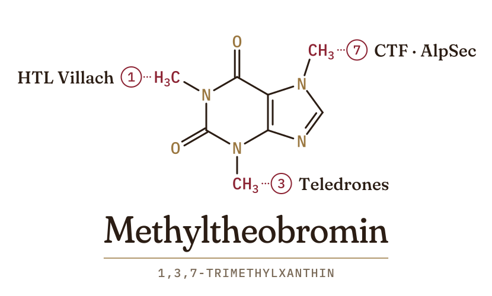
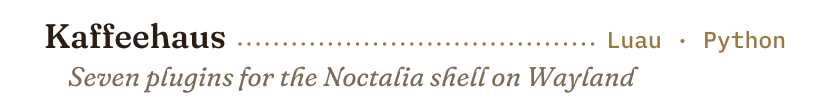
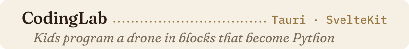
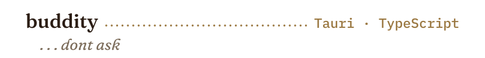
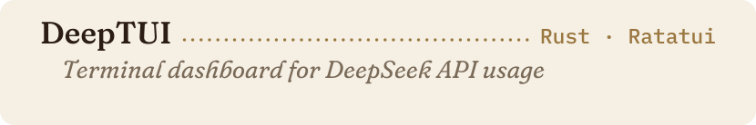

<picture><source media="(prefers-color-scheme: dark)" srcset="./assets/hero-dark.svg"><source media="(prefers-color-scheme: light)" srcset="./assets/hero-light.svg"></picture>

**Maxi** · Villach, Austria · 1,3,7-trimethylxanthine

- **1 · HTL Villach**: Informatik, Matura 2027
- **3 · Teledrones GmbH**: part-time fullstack dev, drone mapping, since 2024
- **7 · CTF**: on-site, pwn · rev · crypto · web, AlpSec member (website & Discord)
- **Stack**: Rust · TypeScript · Svelte · Tauri 2 · Python · Lua, on Hyprland

<picture><source media="(prefers-color-scheme: dark)" srcset="./assets/karte-head-dark.svg"><source media="(prefers-color-scheme: light)" srcset="./assets/karte-head-light.svg"></picture><a href="https://github.com/137-Trimethylxanthin/noctalia-kaffeehaus"><picture><source media="(prefers-color-scheme: dark)" srcset="./assets/karte-noctalia-kaffeehaus-dark.svg"><source media="(prefers-color-scheme: light)" srcset="./assets/karte-noctalia-kaffeehaus-light.svg"></picture></a><a href="https://github.com/137-Trimethylxanthin/stundenglas"><picture><source media="(prefers-color-scheme: dark)" srcset="./assets/karte-stundenglas-dark.svg"><source media="(prefers-color-scheme: light)" srcset="./assets/karte-stundenglas-light.svg"></picture></a><a href="https://github.com/137-Trimethylxanthin/AURA-Junction"><picture><source media="(prefers-color-scheme: dark)" srcset="./assets/karte-aura-junction-dark.svg"><source media="(prefers-color-scheme: light)" srcset="./assets/karte-aura-junction-light.svg"></picture></a><a href="https://github.com/137-Trimethylxanthin/HTL-Vill-Codinglab"><picture><source media="(prefers-color-scheme: dark)" srcset="./assets/karte-htl-vill-codinglab-dark.svg"><source media="(prefers-color-scheme: light)" srcset="./assets/karte-htl-vill-codinglab-light.svg"></picture></a><a href="https://github.com/137-Trimethylxanthin/buddity"><picture><source media="(prefers-color-scheme: dark)" srcset="./assets/karte-buddity-dark.svg"><source media="(prefers-color-scheme: light)" srcset="./assets/karte-buddity-light.svg"></picture></a><a href="https://github.com/137-Trimethylxanthin/DeepTUI"><picture><source media="(prefers-color-scheme: dark)" srcset="./assets/karte-deeptui-dark.svg"><source media="(prefers-color-scheme: light)" srcset="./assets/karte-deeptui-light.svg"></picture></a>

## Tagesempfehlung

| Event | Kind | Where, when | Result |
| --- | --- | --- | --- |
| Cursor Hackathon Vienna | Hackathon | Vienna, 18 Dec 2026 | Up next |
| Junction 2026 | Hackathon | Espoo, Nov 2026 | Took part with team KuK Hofclankerei and built [AURA](https://github.com/137-Trimethylxanthin/AURA-Junction) |
| ACSC 2026 (Austria Cyber Security Challenge) | CTF, attack/defense final | Linz, Sep 2026 | **1st place**, junior category, team Finanzonline |
| KNAPP Coding Contest 2026 | Programming contest | Graz, Feb 2026 | **1st place** |

## Zahlen

<picture><source media="(prefers-color-scheme: dark)" srcset="https://github-readme-stats-kappa-dusky.vercel.app/api?username=137-Trimethylxanthin&show_icons=true&hide_rank=true&theme=transparent&hide_border=true&bg_color=00000000&disable_animations=true&title_color=D0596A&text_color=EFE4D2&icon_color=CDAA6E"><source media="(prefers-color-scheme: light)" srcset="https://github-readme-stats-kappa-dusky.vercel.app/api?username=137-Trimethylxanthin&show_icons=true&hide_rank=true&theme=transparent&hide_border=true&bg_color=00000000&disable_animations=true&title_color=8C2333&text_color=2B1D14&icon_color=9A7740"></picture>
<picture><source media="(prefers-color-scheme: dark)" srcset="https://github-readme-stats-kappa-dusky.vercel.app/api/top-langs/?username=137-Trimethylxanthin&layout=compact&exclude_repo=AURA-Junction&theme=transparent&hide_border=true&bg_color=00000000&disable_animations=true&title_color=D0596A&text_color=EFE4D2&icon_color=CDAA6E"><source media="(prefers-color-scheme: light)" srcset="https://github-readme-stats-kappa-dusky.vercel.app/api/top-langs/?username=137-Trimethylxanthin&layout=compact&exclude_repo=AURA-Junction&theme=transparent&hide_border=true&bg_color=00000000&disable_animations=true&title_color=8C2333&text_color=2B1D14&icon_color=9A7740"></picture>

<picture><source media="(prefers-color-scheme: dark)" srcset="https://github-readme-activity-graph.vercel.app/graph/?username=137-Trimethylxanthin&bg_color=00000000&hide_border=true&area=true&color=EFE4D2&title_color=D0596A&line=D0596A&point=CDAA6E&area_color=D0596A"><source media="(prefers-color-scheme: light)" srcset="https://github-readme-activity-graph.vercel.app/graph/?username=137-Trimethylxanthin&bg_color=00000000&hide_border=true&area=true&color=2B1D14&title_color=8C2333&line=8C2333&point=9A7740&area_color=8C2333"></picture>

<picture><source media="(prefers-color-scheme: dark)" srcset="https://github-readme-streak-stats.herokuapp.com/?user=137-Trimethylxanthin&hide_border=true&background=00000000&ring=D0596A&fire=CDAA6E&currStreakLabel=D0596A&currStreakNum=EFE4D2&sideNums=EFE4D2&sideLabels=9C8B78&dates=9C8B78&stroke=9C8B78"><source media="(prefers-color-scheme: light)" srcset="https://github-readme-streak-stats.herokuapp.com/?user=137-Trimethylxanthin&hide_border=true&background=00000000&ring=8C2333&fire=9A7740&currStreakLabel=8C2333&currStreakNum=2B1D14&sideNums=2B1D14&sideLabels=7A6A58&dates=7A6A58&stroke=7A6A58"></picture>

<picture><source media="(prefers-color-scheme: dark)" srcset="https://raw.githubusercontent.com/137-Trimethylxanthin/137-Trimethylxanthin/output/snake-dark.svg"><source media="(prefers-color-scheme: light)" srcset="https://raw.githubusercontent.com/137-Trimethylxanthin/137-Trimethylxanthin/output/snake-light.svg"></picture>

## Socials

<kbd>[GitHub](https://github.com/137-Trimethylxanthin)</kbd> &nbsp; <kbd>[LinkedIn](https://www.linkedin.com/in/max-sitter-5408a3304/)</kbd> &nbsp; <kbd>[Discord](https://discordapp.com/users/451712143050670080)</kbd> &nbsp; <kbd>[AlpSec](https://alpsec.at)</kbd>

C8H10N4O2 · 194.19 g/mol

